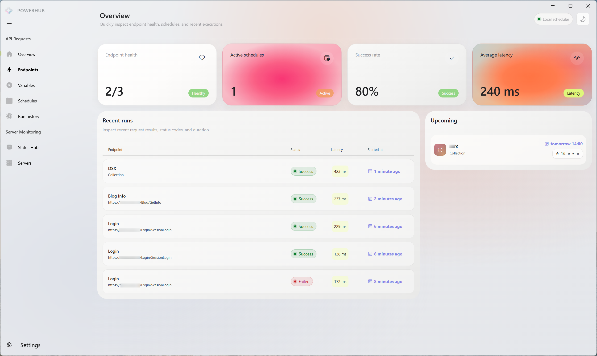
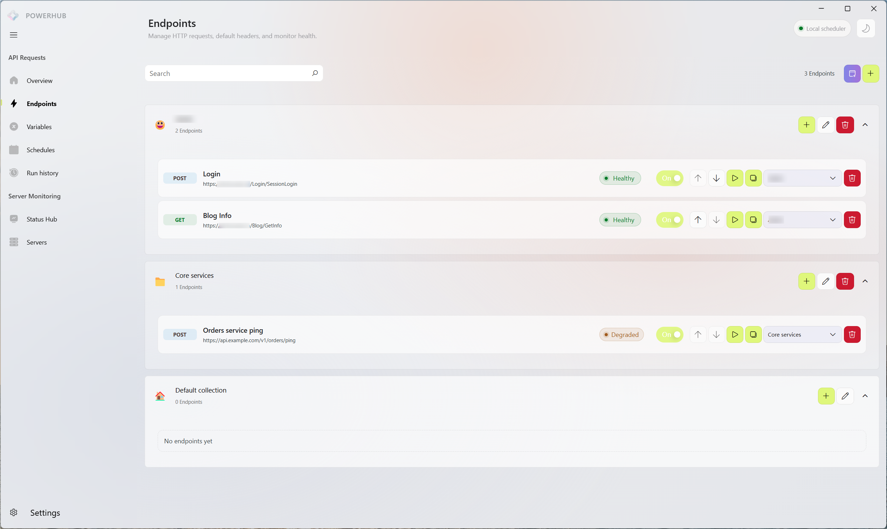
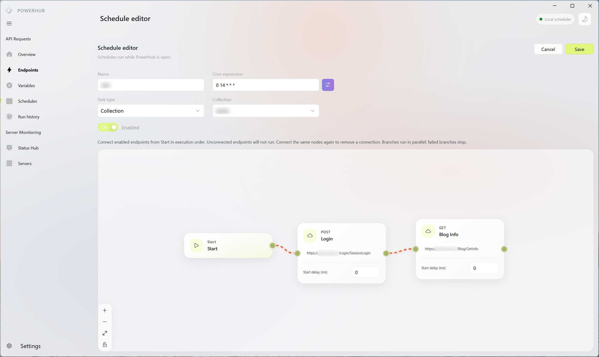
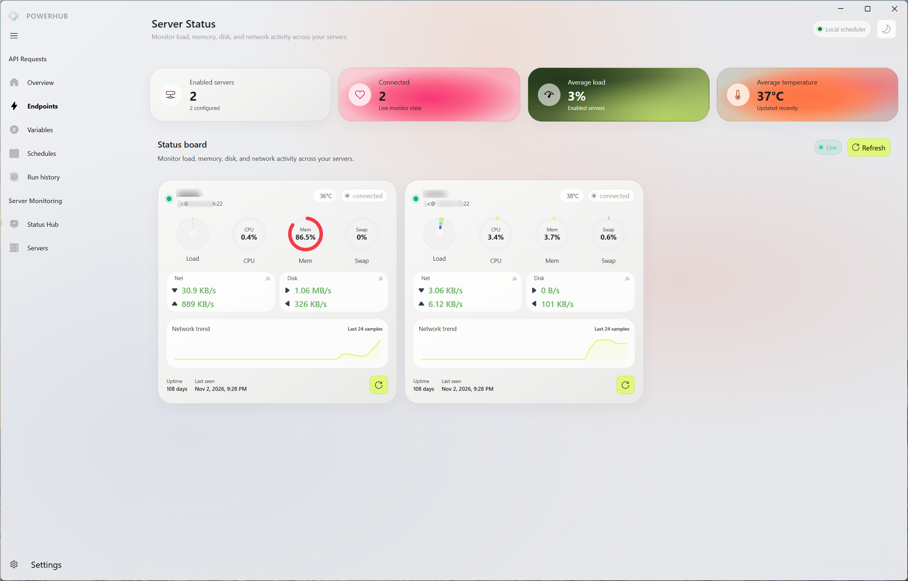
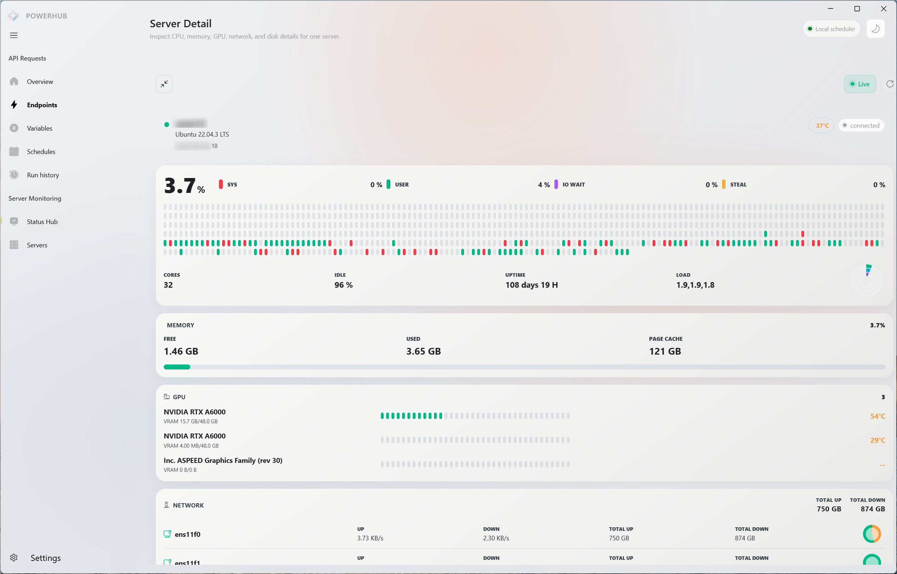
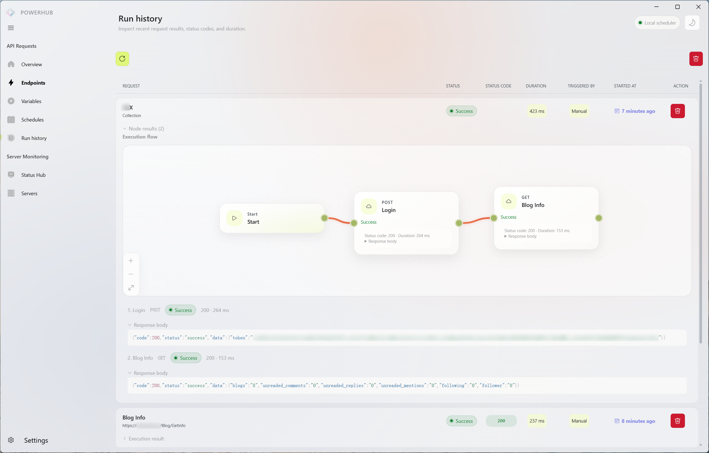
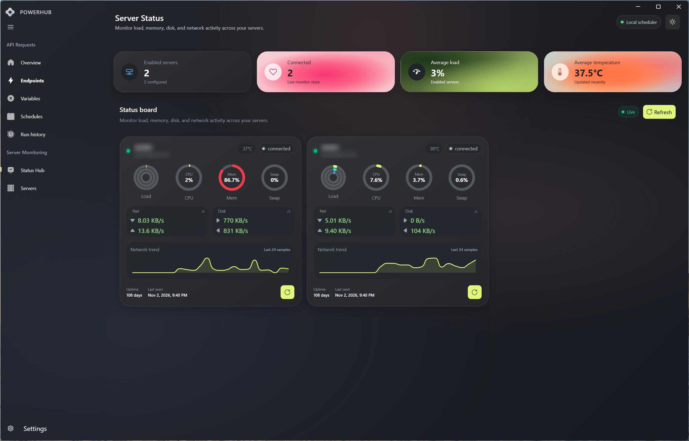

<div align="center">
  
  <h1>PowerHub</h1>
  <p><strong>Your servers, APIs, and automations in one workspace.</strong></p>
  <p>A cross-platform desktop companion for monitoring servers, exploring APIs, and orchestrating scheduled requests.</p>
  <p>
    <a href="https://github.com/aleversn/PowerHub/releases"></a>
    <a href="https://github.com/aleversn/PowerHub/releases"></a>
    
    
  </p>
  <p><strong>English</strong> | <a href="./README_zh.md">简体中文</a></p>
  <p><a href="#-quick-start">Quick Start</a> · <a href="#-features">Features</a> · <a href="#-example-workflows">Use Cases</a> · <a href="./docs/development.md">Developer Guide</a> · <a href="https://github.com/aleversn/PowerHub/releases">Downloads</a></p>
</div>

---

## ✨ Meet PowerHub

Keeping a personal server running often means switching between a monitoring dashboard, an API client, and a collection of scripts. PowerHub brings those everyday tasks together in a desktop workspace inspired by ServerCat and Postman.

Connect to your servers, organize requests into collections, and turn repeated API calls into visual workflows. When a task needs to run regularly, give it a schedule and inspect its execution history from the same application.

> **Project status:** PowerHub is under active development. It creates sample data on first launch. Real HTTP requests and SSH operations contact the targets you configure. Scheduled jobs run only while the application is running; PowerHub is not a hosted cloud scheduler.

## 🖼️ Preview

### Dashboard



### API workspace and visual orchestration

| API workspace | Visual workflow |
| --- | --- |
|  |  |

### Server monitoring

| Server overview | Server details |
| --- | --- |
|  |  |

### Execution history and dark theme

| Execution history | Dark theme |
| --- | --- |
|  |  |

## 🚀 Features

### 🖥️ Server monitoring

- Manage server connections and test SSH connectivity.
- Inspect server details such as CPU, memory, disk, network, uptime, and available GPU information.
- Review metrics in a visual dashboard. Available details depend on the remote machine and its tools; collection currently targets Linux-style system interfaces.

### 📬 API workspace

- Organize endpoints into collections and send HTTP requests from the desktop app.
- Inspect responses and reuse collection variables in requests and scripts.
- Use pre-request and post-response scripts to support repeatable request workflows.

### 🔀 Visual automation

- Arrange enabled endpoints on a flow canvas and connect them through dependencies.
- Configure node delays and run either one endpoint or a collection flow.
- Review run status and node results; downstream nodes are skipped when a dependency fails.

### ⏰ Scheduled execution

- Schedule a request or flow with a five-field cron expression.
- Run tasks manually while developing them, then review their history.
- Keep the application running for automatic executions; missed runs are not a replacement for an always-on cloud service.

### 🎨 A desktop workspace

- Windows and macOS release builds, with a Linux packaging configuration available.
- Light and dark themes, plus English and Chinese interfaces.
- Local SQLite storage for the workspace, with Electron main-process services behind the preload bridge.

## 💡 Example workflows

The examples below illustrate ways to use PowerHub with your own services; they are not preconfigured integrations.

| Scenario | What you can do |
| --- | --- |
| Personal server check | Connect to a Linux server over SSH and inspect its CPU, memory, disk, and network metrics. |
| API development | Group related endpoints in a collection, reuse a base URL as a variable, and inspect responses as you iterate. |
| Repeated maintenance calls | Connect a set of endpoints in a flow, add delays where needed, and schedule it while PowerHub is running. |
| Review a failed workflow | Open a run record to see which nodes succeeded, failed, or were skipped after a dependency failed. |

A simple flow might look like this:

```text
Start → Prepare request → Refresh data → Verify result
```

Each step represents an endpoint you configure. Choose a test service and confirm what each request does before scheduling it.

## ⚡ Quick start

### Download

Find Windows and macOS packages on the [GitHub Releases page](https://github.com/aleversn/PowerHub/releases). Builds are currently unsigned and macOS builds are not notarized, so your operating system may display a security prompt.

### Run from source

**Prerequisites:** Node.js 22 or later, Yarn 1.x, and native build tools for `better-sqlite3` when required.

```bash
git clone https://github.com/aleversn/PowerHub.git
cd PowerHub
yarn install --frozen-lockfile
yarn dev
```

To build or package the app:

```bash
yarn lint
yarn build
yarn build:win   # Windows
yarn build:mac   # macOS
```

See the [Developer Guide](./docs/development.md) for architecture, packaging, and release details. The guide is currently in Chinese.

## 🧭 Getting started in the app

1. **Explore the workspace.** The first launch includes sample data to help you find your way around.
2. **Add a server.** Configure an SSH connection to a machine you are authorized to access, then test the connection and inspect its metrics.
3. **Create a request.** Add an endpoint to a collection, configure its URL and other request details, and send it to a test target.
4. **Build a flow.** Connect enabled endpoints, save the schedule, and run it manually to inspect the result.
5. **Schedule it.** Enable a cron schedule when the flow is ready, and keep PowerHub running for automatic execution.

## 🏗️ Built with

| Area | Technology |
| --- | --- |
| Desktop | Electron, electron-vite, electron-builder |
| Interface | Vue 3, Vue Router, Pinia, VFluent3, SCSS |
| Local data | SQLite, better-sqlite3, Drizzle ORM |
| Automation | Vue Flow, cron-parser, Postman sandbox |
| Monitoring | SSH via ssh2 |

## 🤝 Contributing

Issues and pull requests are welcome. For changes, follow the repository's [development conventions](./AGENTS.md), run `yarn lint` and `yarn build`, and describe how you verified the change. Please do not include real credentials or sensitive request data in examples, issues, or logs.
