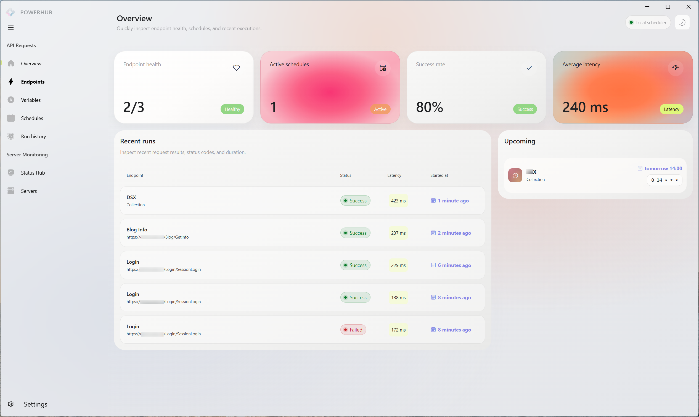
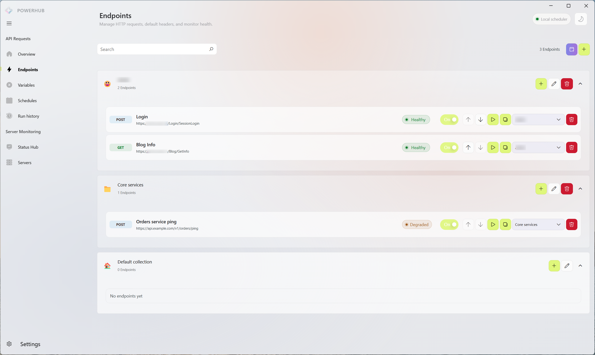
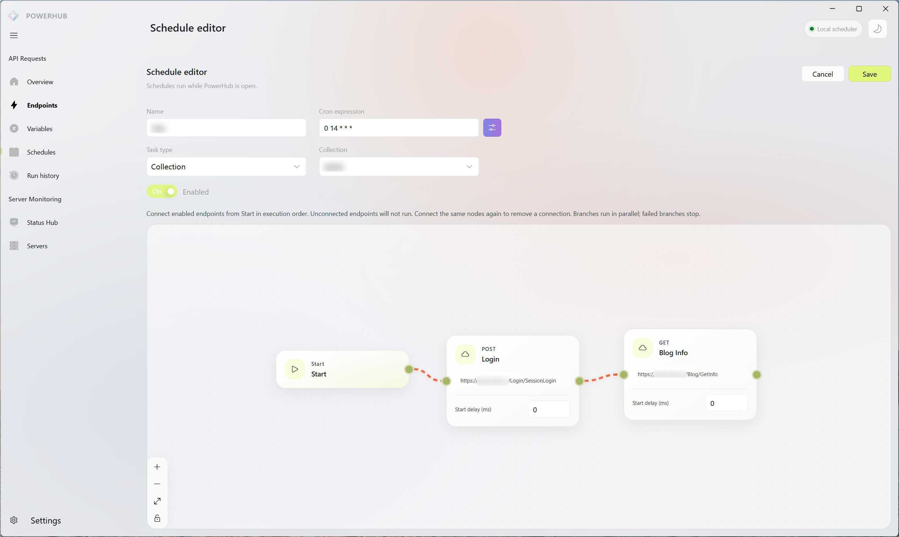
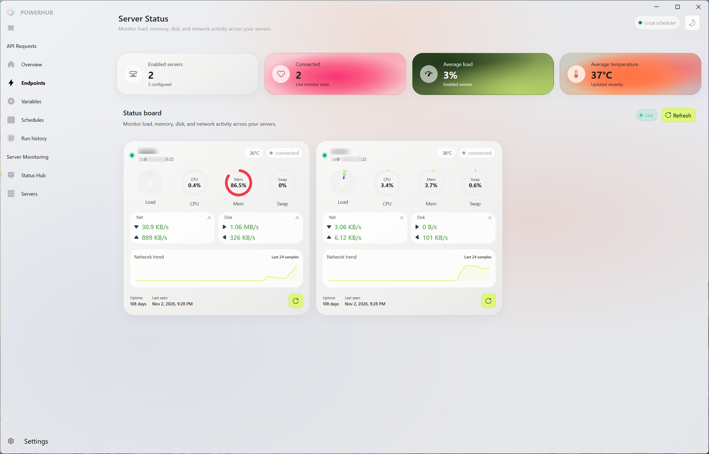
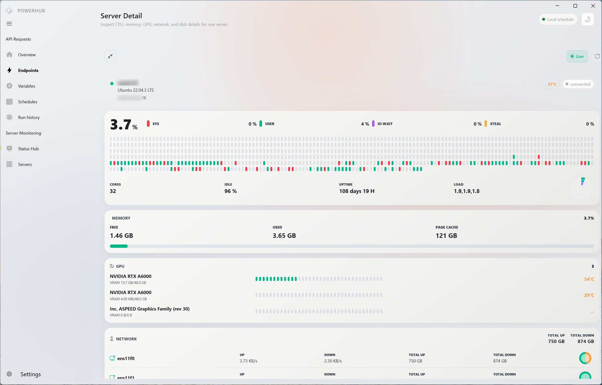
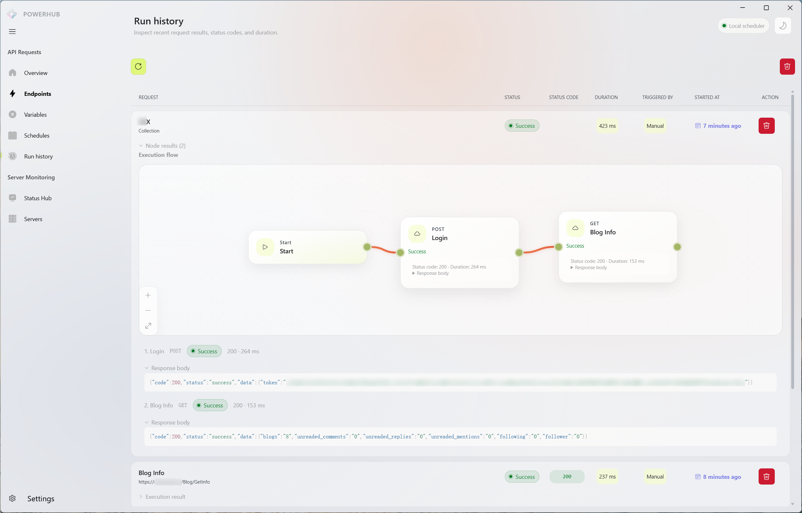
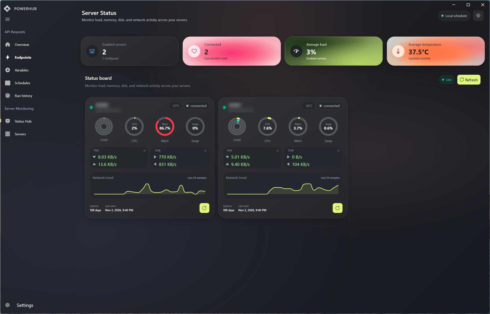

<div align="center">
  
  <h1>PowerHub</h1>
  <p><strong>在一个工作台中管理服务器、接口与自动化任务。</strong></p>
  <p>一个跨平台桌面工具，帮助你监控服务器、调试 API，并编排定时请求。</p>
  <p>
    <a href="https://github.com/aleversn/PowerHub/releases"></a>
    <a href="https://github.com/aleversn/PowerHub/releases"></a>
    
    
  </p>
  <p><a href="./README.md">English</a> | <strong>简体中文</strong></p>
  <p><a href="#-快速开始">快速开始</a> · <a href="#-功能介绍">功能介绍</a> · <a href="#-使用场景">使用场景</a> · <a href="./docs/development.md">开发者文档</a> · <a href="https://github.com/aleversn/PowerHub/releases">下载</a></p>
</div>

---

## ✨ 认识 PowerHub

管理个人服务器时，你可能需要在监控面板、API 客户端和各种脚本之间来回切换。PowerHub 借鉴 ServerCat 和 Postman 的使用体验，将这些日常工作集中到一个桌面工作台。

连接服务器、把请求整理成集合，并将重复调用组合成可视化流程。需要定期执行时，可以为任务设置时间，并在同一个应用中查看运行记录。

> **项目状态：** PowerHub 仍在开发中，首次启动会创建演示数据。真实 HTTP 请求和 SSH 操作会访问你配置的目标。定时任务仅在应用运行时执行，PowerHub 不是托管云调度服务。

## 🖼️ 界面预览

### 工作台总览



### API 工作区与可视化编排

| API 工作区 | 可视化流程 |
| --- | --- |
|  |  |

### 服务器监控

| 服务器总览 | 服务器详情 |
| --- | --- |
|  |  |

### 执行记录与暗黑主题

| 执行记录 | 暗黑主题 |
| --- | --- |
|  |  |

## 🚀 功能介绍

### 🖥️ 服务器监控

- 管理服务器连接并测试 SSH 连通性。
- 查看 CPU、内存、磁盘、网络、运行时间和可获取的 GPU 信息。
- 通过图表查看指标。可用详情取决于远程主机及其工具；当前采集主要面向 Linux 风格的系统接口。

### 📬 API 工作区

- 将接口整理到集合中，在桌面应用内发送 HTTP 请求。
- 查看响应，在请求和脚本中复用集合变量。
- 使用请求前与响应后脚本，支持可重复的请求工作流。

### 🔀 可视化自动化

- 在流程画布中排列已启用的接口，连接节点以定义依赖关系。
- 配置节点延迟，运行单个接口或集合流程。
- 查看运行状态与节点结果；依赖失败时，下游节点会跳过执行。

### ⏰ 定时执行

- 使用五字段 cron 表达式为单个请求或流程设置定时任务。
- 调试时手动执行，并在历史记录中查看结果。
- 自动执行需要保持应用运行；关闭应用期间不会执行任务。

### 🎨 桌面工作台

- 提供 Windows 和 macOS 发布包，并包含 Linux 打包配置。
- 支持浅色、深色主题及中英文界面。
- 工作区使用本地 SQLite 存储，通过 preload 桥接调用 Electron 主进程服务。

## 💡 使用场景

以下是使用自己服务时的示例场景，并非预置集成。

| 场景 | 可以做什么 |
| --- | --- |
| 个人服务器巡检 | 通过 SSH 连接 Linux 服务器，查看 CPU、内存、磁盘和网络指标。 |
| API 开发调试 | 将相关接口放进集合，用变量复用基础 URL，并在调试过程中查看响应。 |
| 重复维护请求 | 将多个接口连接为流程，在需要的地方添加延迟，并在应用运行时按计划执行。 |
| 排查流程失败 | 打开运行记录，查看哪些节点成功、失败，或因依赖失败而跳过。 |

一个简单的流程可以是：

```text
开始 → 准备请求 → 刷新数据 → 验证结果
```

每一步都对应你自己配置的接口。设置定时任务前，请先选择测试服务并确认每个请求的实际作用。

## ⚡ 快速开始

### 下载

在 [GitHub Releases](https://github.com/aleversn/PowerHub/releases) 获取 Windows 和 macOS 安装包。目前构建尚未签名，macOS 包也未公证，系统可能显示安全提示。

### 从源码运行

**环境要求：** Node.js 22 或更新版本、Yarn 1.x；`better-sqlite3` 在需要时还依赖本机原生模块构建工具。

```bash
git clone https://github.com/aleversn/PowerHub.git
cd PowerHub
yarn install --frozen-lockfile
yarn dev
```

构建和打包：

```bash
yarn lint
yarn build
yarn build:win   # Windows
yarn build:mac   # macOS
```

架构、打包与发布说明见 [开发者文档](./docs/development.md)。

## 🧭 开始使用

1. **熟悉工作区：** 首次启动包含演示数据，方便了解界面。
2. **添加服务器：** 配置有权访问的主机的 SSH 连接，测试连通性并查看指标。
3. **创建请求：** 在集合中添加接口，配置 URL 和其他请求参数，向测试目标发送请求。
4. **编排流程：** 连接已启用的接口，保存定时任务，手动运行并检查结果。
5. **设置计划：** 流程准备好后启用 cron 计划，并保持 PowerHub 运行以自动执行。

## 🏗️ 技术栈

| 领域 | 技术 |
| --- | --- |
| 桌面应用 | Electron、electron-vite、electron-builder |
| 界面 | Vue 3、Vue Router、Pinia、VFluent3、SCSS |
| 本地数据 | SQLite、better-sqlite3、Drizzle ORM |
| 自动化 | Vue Flow、cron-parser、Postman sandbox |
| 监控 | 基于 ssh2 的 SSH 连接 |

## 🤝 参与贡献

欢迎提交 Issue 和 Pull Request。修改时请遵循仓库的 [开发约定](./AGENTS.md)，运行 `yarn lint` 和 `yarn build`，并说明验证方式。请勿在示例、Issue 或日志中包含真实凭据或敏感请求数据。
